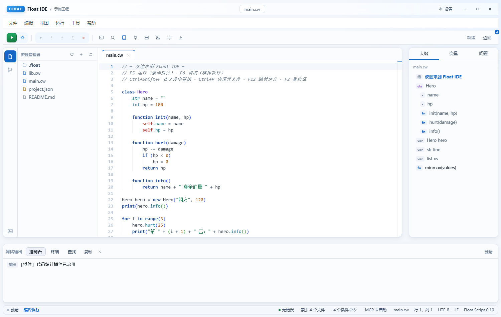
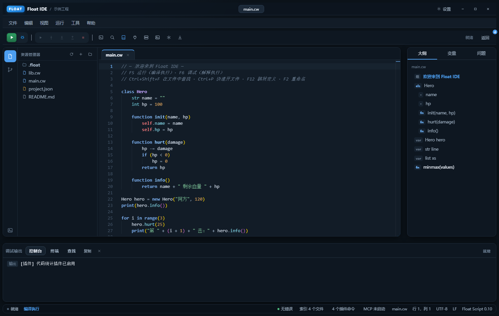
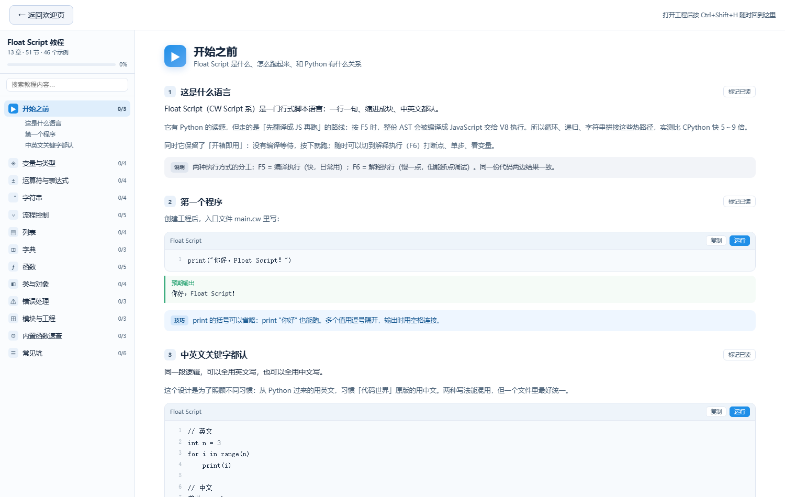
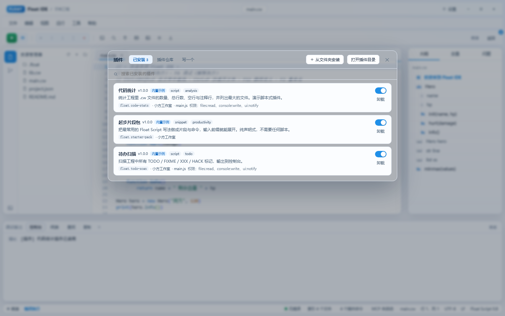
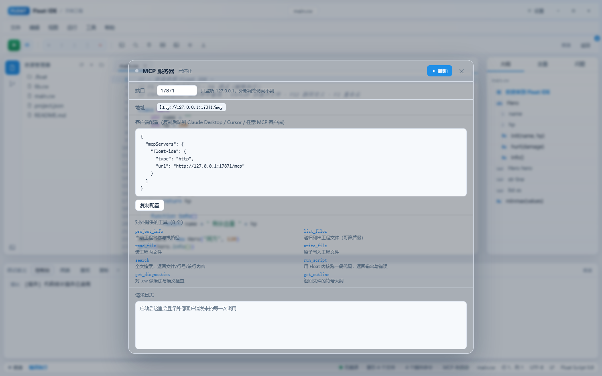

# Float IDE

> 小方工作室出品 ｜ Windows 桌面 ｜ MIT ｜ 完全免费 ｜ 当前版本 0.10.0

**代码世界脚本工作室：给 Float Script（CW Script）一个正经的 IDE。**

「代码世界」（CW Script）是一门行式中文脚本语言：一行一句、缩进成块、指令写结果进特殊变量。原版配套的 IDE 是一个网页沙盒，写代码、打断点都施展不开。Float IDE 把它重做成一个真正的桌面 IDE：Monaco 编辑器、文件树、断点调试、变量查看、真终端、Git，一样不少。

0.2 把语言内核整个换掉了——不再是"一行一条正则"，而是 **词法 → AST → 解释器** 三层。所以 `for` 的次数能写变量、函数能有参数和返回值、类能继承。

---

## 0.10 这次改了什么（视觉系统重做）



### 一套有层级的单色系统

原来只有"白底 + 蓝字"，看着单薄；而靠加黄加红去丰富又是玩具的路子。所以这次做的是**用灰阶和蓝阶撑起层次**：

| 维度 | 层级 |
| --- | --- |
| 表面 | `--s0` 窗口底 → `--s1` 面板 → `--s2` 编辑区 → `--s3` 下沉 → `--s4` 悬停 |
| 边框 | `--b1` 极淡分割 → `--b2` 常规 → `--b3` 强调 |
| 文字 | `--t1` 主 → `--t2` 次 → `--t3` 弱 → `--t4` 极弱 |
| 蓝 | `--a1` 主 → `--a2` 悬停 → `--a3` 淡底 → `--a4` 选中底 |

### 语义色：该有的地方一定给，但都取低饱和档

纯蓝白看久了会单调刺眼，所以该用颜色的地方一个不少——只是不用荧光色：

| 语义 | 颜色 | 用在哪 |
| --- | --- | --- |
| 运行 / 成功 | 墨绿 `#1a7f47` | 运行按钮（绿渐变）、状态点、MCP 运行灯、教程「已读」、输出块 |
| 错误 | 砖红 `#b42318` | 错误行、问题面板、冲突提示、波浪线 |
| 警告 | 琥珀褐 `#8a5a00` | 警告条、提示卡、编辑器警告波浪线 |
| 信息 / 主色 | 蓝 `#1567c6` | 选中、链接、调试按钮、强调 |

运行按钮是**整个界面唯一的绿色区域**，所以一眼就能找到——这是功能性的，不是装饰。

### 语法高亮恢复彩色（低饱和）

关键字深蓝加粗、字符串墨绿、数字赭石、类名紫、类型青、注释灰斜体——彩色的目的是「一眼分出这是字符串还是数字」，全部取 GitHub Light / One Light 那种低饱和档，不刺眼。

### 图标也分类型色

文件树：`.cw` 蓝 / `.json` 琥珀 / `.md` 灰 / 文件夹青灰。
大纲：类紫 `cls` / 方法蓝 `fn` / 变量灰 `var`。扫一眼就知道这行是什么。

### 分区靠明度，不靠色块

```
顶栏(白) ─ 工具栏(浅灰) ─┬─ 活动栏(浅灰) ┬─ 编辑区(白，焦点) ┬─ 大纲(浅灰)
                        └─ 文件树(浅灰) ─┘                  └─ 控制台(浅灰)
                        状态栏(最暗，压住整窗)
```

标签页改成顶部 2px 蓝条 + 实边框，像真 IDE；数字全部等宽对齐；输入框带内阴影给出可点击的实感；滚动条收细到 9px。

深色主题同一套 token，只是把明度阶梯倒过来：



---

## 0.9 这次改了什么（页面化 + 完整教程）

### 界面从"悬浮卡片"改成"一页一页开"

之前的教程、插件、MCP、设置、快捷键、外观全是浮在编辑器上的弹窗——那不像 IDE，像网页应用。
现在这些统统是**编辑器区的标签页**，和 `main.cw` 并排，**带图标**，能关能切：

`📖 学习中心` · `🔌 插件` · `🖥 MCP 服务器` · `⚙ 偏好设置` · `⌨ 快捷键` · `🖼 外观与背景`

浮层只留给真正临时的东西：命令面板、快速打开、重命名、输入/确认框。

### 学习中心：从"十分钟上手"变成真教程


- **13 章 / 51 节 / 46 个可运行示例**，左侧目录 + 右侧正文，像 PyCharm 的帮助页
- 每节都能「标记已读」，左侧显示章节进度、顶部有总进度条
- 代码块带行号，三个按钮：**复制 / 在编辑器中打开 / 运行**
- 点「运行」当场出结果（走真正的语言内核），旁边还标着「预期输出」方便对照
- 目录支持全文搜索；章节之间有上一章/下一章
- 章节结构：开始之前 → 变量与类型 → 运算符 → 字符串 → 流程控制 → 列表 → 字典 → 函数 → 类与对象 → 错误处理 → 模块与工程 → 内置函数速查 → 常见坑

欢迎页点「学习中心」也是整页铺开（不打开工程也能学，示例照样能跑）：



### 顺手修的两个真 bug

| 问题 | 原因 |
| --- | --- |
| Ctrl+P 的快速打开按 Esc 关不掉 | Esc 只在输入框自己的 onKeyDown 里处理，焦点一动就失效。改成全局 Esc 兜底（同时认 `key` 和 `code`） |
| `contributes.menus` 写成对象却按数组遍历 | `object is not iterable`，导致三个内置插件全部报错。现在对象/数组两种形态都吃 |

---

## 0.8 这次改了什么（插件 + MCP + 真 IDE 能力）

### 先说一个把功能全废掉的 bug

「新建文件」点了没反应、「删除」点了没反应、「新建分支」点了没反应——根因是这些地方用的 `window.prompt` / `window.confirm`。
**Tauri v2 的 WebView2 里这两个 API 是未实现的**，调用会静默返回 `null` / `false`，所以看起来就是"什么都没发生"。
现在全部换成自绘对话框（`askText` / `askConfirm`），并且给文件名加了合法性校验、自动补 `.cw` 后缀。

### 插件生态



| 能力 | 说明 |
| --- | --- |
| 插件形态 | 一个文件夹 + `plugin.json`，可选 `main.js`。丢进插件目录就装好，不编译、不重启 |
| 两种写法 | **纯声明式**（命令/片段/补全/菜单全写在清单里）和**脚本式**（`main.js` 用注入的 API 干活） |
| 权限模型 | `files:read` / `editor:write` / `language:run` 等按需申请，越权操作被拒绝且不影响其他插件 |
| 片段真的能用 | `contributes.snippets` 会并进 Monaco 补全，输入前缀直接展开，不是摆设 |
| 管理面板 | 已安装 / 插件仓库 / 写一个（内置教程），支持启用、禁用、从文件夹安装、卸载、打开目录 |
| 离线生态 | 插件目录放 `registry.json` 就是一份索引，团队共享盘即可分发，不需要服务器和账号 |
| 内置示例 | 起步片段包（纯声明）、代码统计（脚本）、待办扫描（脚本），照着改最快 |

容错：**一个插件坏掉不会拖垮其他插件**——每个插件独立加载，错误只落在自己卡片上。

### MCP 服务器



内置 MCP（Model Context Protocol）服务，外部 AI 客户端直接操作工程：

- 传输：Streamable HTTP，`POST /mcp`，只监听 `127.0.0.1`，可随时停止
- 8 个工具：`project_info` / `list_files` / `read_file` / `write_file` / `search` / `run_script` / `get_diagnostics` / `get_outline`
- 文件类在 Rust 里做（快），语言类转给界面执行（**和按 F5 完全同一条通道**，不是模拟）
- 面板里一键复制客户端配置，带请求日志

### 真 IDE 能力

| 功能 | 快捷键 | 说明 |
| --- | --- | --- |
| 在文件中查找 | `Ctrl+Shift+F` | 跨文件搜索，区分大小写 / 全词 / 正则，结果按文件分组、命中高亮，**先预览再替换** |
| 快速打开文件 | `Ctrl+P` | 模糊匹配文件名 |
| 跳转到定义 | `F12` | 跨文件找函数 / 类 / 变量的定义处 |
| 重命名符号 | `F2` | 跨文件重命名，**用词法器区分标识符，注释和字符串里的同名词不会被误改** |

工程索引（`indexer.ts`）是这一层的地基：搜索、定义、引用、重命名都吃同一份 AST 符号表。

修掉的相关 bug：`Ctrl+Shift+P`（命令面板）之前被 `Ctrl+P`（快速打开）抢走了。

### 其它

- 文件树高亮当前打开的文件
- 状态栏显示索引文件数、插件命令数、MCP 端口，都能点
- 工具栏、标签页、面板切换的动效打磨；键盘操作有清晰的焦点环；尊重"减少动效"系统偏好

---

### 文档

- [插件开发指南](docs/plugins.md) —— 清单字段、可用 API、权限、离线生态
- [MCP 服务器](docs/mcp.md) —— 怎么接客户端、8 个工具、协议细节与安全边界
- [语言教程](docs/tutorial.md) —— Float Script 从入门到异常处理

---

## 0.7 这次改了什么（抗造版本）

这一轮的主题是**「自己找 bug」**：专挑会让 IDE 崩、会悄悄丢代码的地方下手。

| 方向 | 问题（原来） | 现在 |
| --- | --- | --- |
| **两个进程冲突** | 两个 Float IDE 同时开同一个工程，互相覆盖谁也不知道 | 工程级心跳锁：第二个窗口打开时明确提示「已有一个 Float IDE（进程 N）在编辑」，不抢锁；崩溃强杀也能自愈（12 秒无心跳自动释放） |
| **文件被外部改动** | 写盘直接覆盖，别人的修改无声消失 | 写前校验 mtime，不一致就挂起并弹条：「已被另一个程序修改」→ 用户选**仍要覆盖**或**放弃我的改动重新加载** |
| **半截文件** | `fsWrite` 直接写目标，读到一半内容的窗口会拿到坏文件 | 改成原子写（临时文件 + rename），任何时刻读到的都是完整内容 |
| **连点运行** | `ctl` 是异步状态，连按 F5 能起两个 Runner，控制台串味、状态错乱 | 同步闸门 + 每次运行发令牌，旧 Runner 的回调一律丢弃；开跑前先掐掉上一个 |
| **保存撞车** | Ctrl+S 与自动保存同时写同一文件；保存期间继续敲的代码会被标成已保存而丢掉 | 单文件写盘串行化 + 内容快照校验：只有「期间没再改动」才清脏标记 |
| **语言核心绑死 DOM** | `interp.ts` 直接用 `window`，换个宿主就崩 | 宿主探测（`window` → `globalThis`），同一份运行时在浏览器 / Node 都能跑 |
| **自引用容器** | `list a = [1]` + `add a to a` 之后 `print a` / 拷贝 / 比较 → 爆栈崩掉 | 环检测：打印成 `[1, …(循环)]`，拷贝与比较保持结构 |
| **无限递归** | 报一句引擎的 `Maximum call stack size exceeded`，没行列、看不懂 | 统一上限 400 层，两条执行通道都报：「递归太深了（超过 400 层）… 多半是 f() 的结束条件没写对」 |
| **静默通过的坏代码** | `if` 不写条件 → 整段分支变成永不执行的死代码；顶层 `return` / `out` 被悄悄吞掉 | 全部给出诊断 |
| **print 语法** | 只有 `print(x)` 能用，`print x` 报「看不懂」 | 括号可选，`print n` / `print a, b` 都可以 |

**长代码实测**（`npm run test:stress`，17 项全过）：

- 4705 行（300 函数 + 50 类 + 3000 变量）解析 34ms、静态分析 26ms、执行 53ms，结果正确
- 2 万行单文件解析 + 执行 130ms；2 万元素列表、2 万次字符串拼接均正常
- 括号嵌套 600 层、缩进嵌套 150 层均可解析
- 13 种残缺语法全部有诊断，0 个静默通过

---

## 0.6 这次改了什么

| 方向 | 变化 |
| --- | --- |
| **AST** | 字符串支持 `{表达式}` 插值（变量、运算、函数、方法都能塞进去）；列表/字典/嵌套/立即调用等位置全部验证通过 |
| **报错** | 新增静态检查：未定义变量与函数在写的时候就标黄，并给「是不是想写 xxx」；右侧新增「问题」面板，语法错、未定义、运行错汇总，点一条跳一行 |
| **界面** | 标题栏改成品牌 + 工程名；新增偏好设置（主题浅色 / 深色 / 跟随系统、字号、缩进、换行、自动保存、F5 执行方式）；深色主题连编辑器一起换 |
| **编辑体验** | 自动保存（默认开，可在设置里关）；控制台一键复制；`Ctrl+Alt+S` 打开设置 |
| **终端 / 控制台** | 终端是 xterm.js + ConPTY 真 PowerShell（多标签、可缩放）；控制台输出 / 错误 / 信息分色、ask 输入、复制与清空都是真实的 |

---

## 0.5 这次改了什么

| 位置 | 变化 |
| --- | --- |
| 菜单栏 | 顶部补上 `文件 / 编辑 / 视图 / 运行 / 帮助` 五组菜单，每项都带快捷键提示，全部真实可用（不再只有按钮） |
| 快捷键 | 补齐一整套：`Ctrl+N/O/S/W`、`Ctrl+Z/Y/F/H/G`、`Ctrl+/`、`Ctrl+±`、`Alt+1/2/3`、`F1`、`F9`（切换断点）等；`F1` 打开快捷键一览 |
| 窗口按钮 | 三大金刚键之前点不动，是 Tauri 权限清单没放行（只有 `core:default`）。已补 `allow-minimize / allow-toggle-maximize / allow-close / allow-start-resize-dragging` |
| 工程包 | 扩展名从 `.floatzip` / `.float` 改成 `.cw`，选文件过滤器也认 `.cw`；老包仍可导入 |
| 标题栏 | 修掉静态引入 Tauri 模块导致浏览器预览整页白屏的问题，改回按需加载 |

---

## 0.4 这次改了什么

| 方向 | 变化 |
| --- | --- |
| **界面** | 按 PyCharm 新 UI 重做：自绘标题栏（无系统边框）、图标工具栏、左侧项目栏、居中大标题欢迎页；三处面板依旧可拖动 |
| **自定义背景** | 可上传自己的图片做整窗背景，透明度 / 模糊 / 压暗三个滑杆实时预览，设置存在本地 |
| **语言** | 新增 `try / catch / finally`、`throw`、方法与链式调用（字符串 / 列表 / 字典）、多返回值与解构 |
| **修错** | 开发端口与 devUrl 对齐（1430），不再和 Tempus 的 1429 抢端口；重打安装包，别再用旧 exe |

### 0.4 新增语言能力速览

```text
try
    throw "出错了"
catch e
    print("抓到：" + e.message + "（第 " + e.line + " 行）")
finally
    print("一定执行")

print("  hello ".trim().upper())      // HELLO
list xs = [3, 1, 2]
xs.sort()
print(xs.join("-"))                    // 1-2-3

function minmax(xs)
    return 1, 9
int low, int high = minmax([])
```

---

## 0.3 这次改了什么

| 方向 | 变化 |
| --- | --- |
| **速度** | 新增编译执行通道：按 F5 时把 AST 编译成 JavaScript 交给 V8。`fib(30)` 21ms（CPython 3.13 是 114ms），500 万次累加 15ms（133ms） |
| **界面** | 白底 PyCharm 风 + 磨砂玻璃面板；侧栏 / 大纲 / 控制台三处都能拖动，宽度记在本地；新增底部状态栏（编译模式、错误数、行列、编码） |
| **教程** | 新写 `docs/tutorial.md`：从第一行 `print` 一直写到类与继承，附完整可运行小游戏 |
| **调试分工** | F5 走编译（最快），F6 走解释器（断点单步），两套引擎语义一致 |
| **修坑** | `out` 当变量名不再被误当成 break；`for` 里循环变量、类方法互调、`super()` 传参全部对齐 |

### 实测性能（Windows / Node 22 / CPython 3.13）

| 用例 | Float（编译执行） | CPython 3.13 | 倍率 |
| --- | --- | --- | --- |
| `fib(30)` 递归 | 21 ms | 114 ms | 快 5.4 倍 |
| `for` 累加 500 万次 | 15 ms | 133 ms | 快 8.8 倍 |
| 字符串拼接 5 万次 | 2.5 ms | 2.9 ms | 快 1.2 倍 |

编译本身只花 0.1–0.3 ms —— 所以是"按下就跑"，不存在等编译。

---

## 0.2 这次改了什么

| 之前（0.1.0） | 现在（0.2.0） |
| --- | --- |
| 正则逐行匹配，参数都是裸字符串 | 手写词法 + Pratt 表达式解析，参数是真正的 AST 节点 |
| `for i in range(3)` 只认数字字面量 | 次数可以是变量、算式、函数调用；循环变量任意取名且真正可用 |
| 函数只能无参，带参"未打通" | 多参数、默认值、返回值、递归，能写在任意表达式里 |
| 没有类 | `class` / `new` / `self` / `extends` / `super` 全套 |
| 声明变量只能写字面量 | 初始化走完整表达式；支持 `[1,2]`、`{"k":1}` 字面量 |
| 写错只能运行时才发现 | 边写边解析，红波浪线实时标出语法错误 |
| 补全靠正则扫源码 | 补全来自 AST 符号表：类成员、方法签名、参数、局部变量 |

语言测试 54 项，全部通过（`npm run test:lang`）。

---

## 先看这一条

| 你可能想问 | 答案 |
| --- | --- |
| 什么是 Float Script？ | 即 CW Script（代码世界）去掉舞台相关指令后的核心语言，0.2 在原语法上补齐了函数参数、类、表达式。规范见 `language/catalog/core.json` |
| 语法难吗？ | 一行一句，回车就是新语句，缩进就是进块。指令与内建函数悬停可查中文文档 |
| 和原版沙盒什么关系？ | 语言行为向下兼容原版（老脚本照跑），并做了向后兼容的扩展；工程形态是本地文件夹 + `project.json` |
| 要钱吗？要登录吗？ | 不要钱，不要账号，MIT 许可，不联网 |
| 有 macOS / 手机版吗？ | 没有，只做 Windows 桌面 |

---

## 下载就能用

| 文件 / 目录 | 是什么 |
| --- | --- |
| `Float IDE.lnk` | 快捷方式，指向源码构建产物 exe |
| `scaffold/` | 完整源码（Tauri 2 + React + Monaco） |
| `language/` | 语言规范（catalog）与示例脚本（samples） |
| `docs/tutorial.md` | 教程：从第一行代码写到类与继承 |
| `scaffold/demo.html` | 界面预览页（`npm run dev` 后访问，用假后端跑真实界面） |

---

## 现在支持的全部功能

### 语言（0.2 内核）

| 能力 | 说明 |
| --- | --- |
| 行式语法 | 一行一句，缩进定块，`{ }` 可选，行尾 `;` 忽略，`--` 整行跳过 |
| 表达式 | 完整优先级、一元/二元运算符、`&& \|\| !` 短路、字符串转义、列表与字典字面量、下标、成员访问 |
| 循环 | `for i in range(n)`（n 可为表达式）、`range(a,b,step)`、`for x in 列表/字符串/字典`、`for k, v in 字典`、`for i = 1 to 10 step 2`、`while`、`repeat`、`forever` |
| 跳转 | `break` / `out`、`balo` / `continue`、`if out(条件)`、`stop` |
| 函数 | 多参数、默认值（可引用前面的参数）、`return`、递归、先用后定义；函数内局部变量不污染全局 |
| 类 | 字段默认值、`init` 构造、方法互调、`self`、继承与 `super(…)`、对象进列表后逐项调方法 |
| 内建函数 | 数学 / 比较 / 逻辑 / 字符串 / 集合 / 类型转换共 60 余个，可在任意表达式里调用 |
| CW 兼容 | 独立成行的 `add(a, b)` 之类仍写 `__last_calc`；`__last_*`、`ans`、`ask`、`import` 行为不变 |
| 错误 | 语法错误带行列与中文说明；运行错误带文件行号与调用栈（`在 xxx() 中，由 yyy() 调用`） |

### 编辑器

| 能力 | 说明 |
| --- | --- |
| 语法高亮 | 为 `.cw` 定制 Monarch 词法：关键字 / 类型 / 函数名 / 类名 / 成员 / 字符串 / 注释 / 特殊变量分色 |
| 智能补全 | 指令、内建函数、特殊变量、本文件函数（带参数）、类、成员：`p.` 后列出该类的字段与方法，`self.` 给当前类的成员 |
| 签名提示 | 光标在括号里时显示参数表，并高亮当前第几个参数 |
| 实时诊断 | 输入即解析，语法错误立刻打红波浪线，悬停看原因 |
| 悬停文档 | 指令 / 内建函数 / 关键字 / 函数 / 类 / 字段 / 特殊变量，悬停即出说明 |
| 多标签页 | 未保存打点，Ctrl+S 保存全部 |
| 大纲面板 | AST 驱动：组标记、类、字段、方法、函数、顶层变量，按层级缩进，点击跳行 |
| diff 视图 | Git 面板点文件即看左右分屏差异 |

### 运行与调试

| 操作 | 按键 | 说明 |
| --- | --- | --- |
| 运行 | F5 | 整脚本执行，输出进控制台 |
| 调试 | F6 | 断点生效，停在第一条语句 |
| 继续 | F8 | 跑到下一个断点 |
| 单步跳过 / 进入 / 跳出 | F10 / F11 / Shift+F11 | 逐语句跟，函数整段跳过或钻进去 |
| 停止 | Shift+F5 | 随时终止 |

- 断点：编辑器行号左侧空白单击切换，红点即断点
- 执行行高亮：暂停时当前语句黄色箭头标记
- 变量查看器：暂停即快照全部变量（含对象字段、局部与全局）
- ask 提问：控制台弹出输入行，回答回车继续
- wait：真实挂起等待，不空转
- 防死循环：单次运行 200 万步上限，各循环 100 万次迭代守卫，冻结不了界面

### 控制台与终端

- 控制台：输出 / 错误 / 信息分色，错误带调用栈，ask 交互输入行
- 终端：Ctrl+` 呼出，xterm.js + 真实 PowerShell 子进程（ConPTY），npm / git 随便敲，多标签

### Git 完整版

源代码管理面板：暂存 / 取消暂存 / 逐文件 diff、提交（Ctrl+Enter）、分支切换 / 新建 / 删除、提交历史、push / pull / remote、init。未装 Git 时给提示而不是装死。

### 工程管理

- 工程就是一个普通文件夹：`project.json` + `main.cw`，别的编辑器改也认
- 新建工程四模板：**空白工程**、**入门示例**（变量/条件/循环/列表）、**进阶示例**（函数/集合/字典/计时）、**类与对象**（字段/方法/继承）
- 导入工程包 / 导出工程包（`.cw`，ZIP 容器），拷给别人、换机搬家一个文件
- 最近工程：一点就回，可逐条移除

---

## 语言十行上手

```text
class Hero
    str name = ""
    int hp = 100

    function init(name)
        self.name = name

    function hurt(damage)
        hp -= damage
        return hp

Hero h = new Hero("阿方")
print(h.name + " 剩余 " + h.hurt(30))
```

要点（详见 `language/catalog/core.json`）：

- **一行一句**：缩进定块，`{ }` 可写可不写，`--` 开头整行跳过
- **表达式到处能用**：赋值右值、`print`、`if`/`while` 条件、`for` 的次数、函数参数都走同一套解析
- **循环变量真可用**：`for i in range(n)` 里的 i 每轮绑定，嵌套循环各用各的
- **函数**：`function name(a, b = 1)` 定义，`name(1)` 调用，`return` 返回值，可递归
- **类**：`class Name` + 字段 + `init` + 方法；`new Name(…)` 创建；方法里字段可裸名读写
- **特殊变量**：`add / lt / join / read / time read` 等指令的结果仍写进 `__last_calc / __last_cmp / __last_str / __last_read / __last_time`；`ask` 的回答存 `ans`
- **条件运算符**：用 `> < == != && || !`，不用 and / or / not 关键字
- **import**：`import "lib.cw"` 按文件，`import "tools"` 按文件夹（找 `tools/main.cw`）

五份示例在 `language/samples/`，从 hello 到类与继承。

---

## 自己构建

| 需要 | 说明 |
| --- | --- |
| Windows 10 / 11 | 只做 Windows 桌面 |
| Node.js 18+ | 前端构建，Vite 5 |
| Rust 1.75+ | 后端，Tauri v2 |
| WebView2 | Windows 10 / 11 一般自带 |

```bash
cd scaffold
npm install
npm run dev          # 只跑前端，浏览器里看界面
npm run tauri dev    # 跑完整桌面应用
npm run tauri build  # 打包 MSI
npm run test:lang    # 语言内核测试（54 项）
npm run bench:lang   # 性能基准（对比 CPython）
```

---

## 目录结构

```
Float/
├── README.md                  本文件
├── scaffold/                  完整源码
│   ├── src/
│   │   ├── lang/              语言引擎
│   │   │   ├── token.ts       词法
│   │   │   ├── ast.ts         AST 节点定义
│   │   │   ├── parse.ts       缩进块 + Pratt 表达式 → AST
│   │   │   ├── values.ts      值模型（列表 / 字典 / 类实例）
│   │   │   ├── builtins.ts    内建函数表
│   │   │   ├── codegen.ts     AST → JS 编译器（运行通道，快）
│   │   │   ├── interp.ts      解释器与调试控制器（调试通道）
│   │   │   ├── analyze.ts     AST → 符号表（补全/悬停/大纲）
│   │   │   ├── floatlang.ts   Monaco 语言支持
│   │   │   └── spec.ts        指令与关键字文档
│   │   ├── ide/               编辑器、文件树、控制台、终端、Git 面板
│   │   ├── workspace/         工作台接线（运行/调试/断点）
│   │   └── core/              Tauri 封装、模板、类型
│   ├── tests/                 语言测试（harness + 48 项用例）
│   └── src-tauri/             后端：Rust（文件 / 工程 / ConPTY 终端 / Git）
└── language/
    ├── catalog/               语言规范（core.json 为权威）
    └── samples/               五份示例脚本
```

---

## 常见问题

**F5 和 F6 结果一样，速度差那么多？**
F5 把代码编译成 JS 跑（快），F6 用解释器逐行跑（能停、能看变量）。语义是一套，结果相同。

**双击没反应 / 白屏？**
确认装了 WebView2（Windows 11 一般自带）。自己构建的先在 `scaffold/` 里 `npm install`。

**运行没反应？**
看控制台报错。语法有错时会先列出全部错误行，改完再跑。

**调试时断点不停？**
断点在调试模式（F6）才生效，直接 F5 运行是不停的。改完代码记得 Ctrl+S 再跑。

**类的方法里为什么能直接写 `hp` 而不是 `self.hp`？**
这是有意设计：方法内先找局部变量，再找当前对象的字段。写 `self.hp` 更明确，两种都行。

**和原版 CW Script 工程通用吗？**
脚本语法向下兼容；原版网页里的舞台 / 角色相关指令不在本语言范围内。原版参考材料在 `reference/`。

---

## 许可与边界

- **MIT 许可**，非营利，小方工作室出品。
- **不联网**：无账号、无更新检查、无遥测。
- **全中文界面**，Windows 优先。
- 语言规范基于「代码世界 CW Script」，本软件为独立重制的桌面 IDE。

---

*小方工作室 · Float IDE · 给代码世界一个正经的 IDE*
