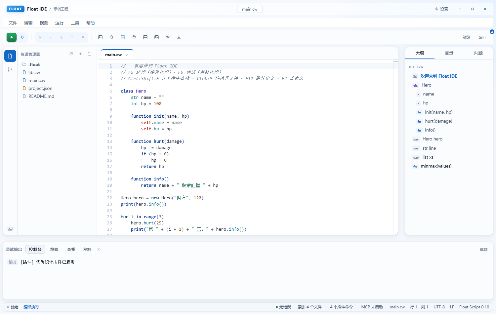
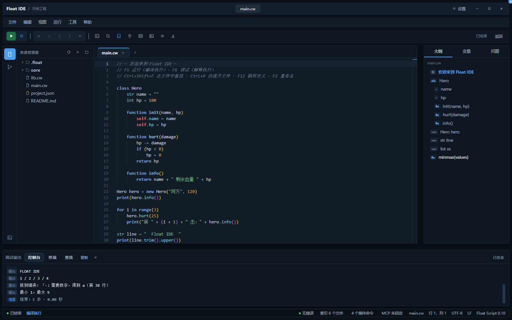
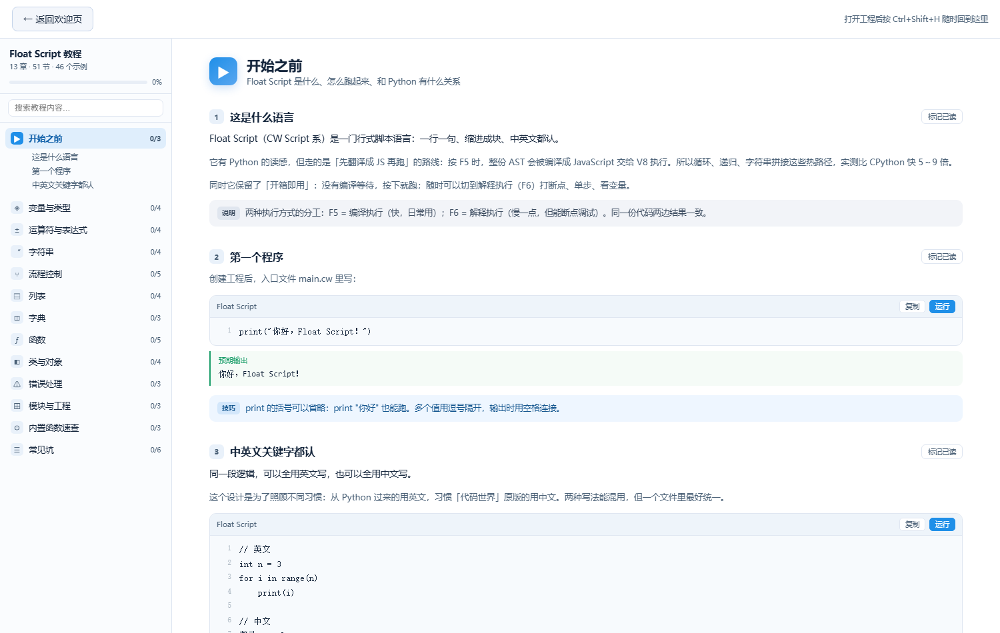
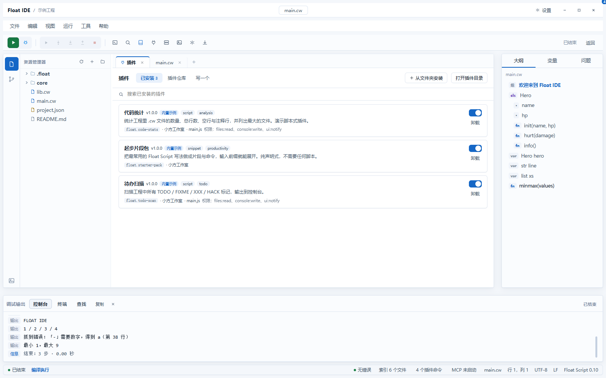
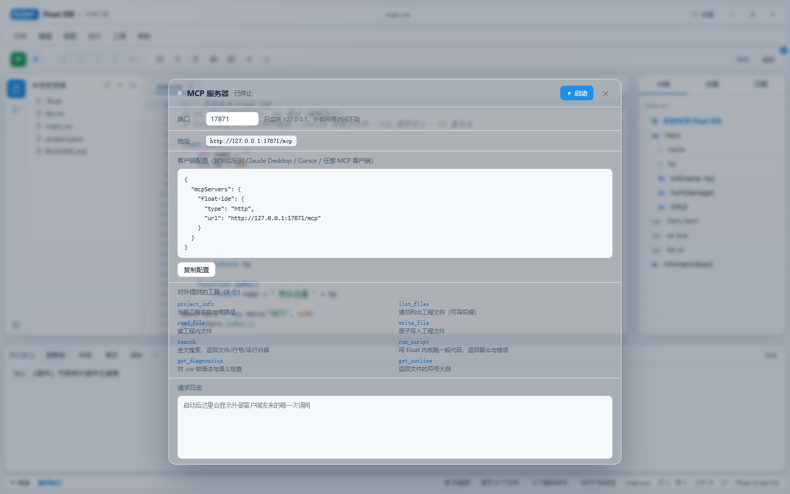

# Float IDE

> 小方工作室出品 ｜ Windows 桌面 ｜ MIT ｜ 完全免费 ｜ 当前版本 1.7.1 ｜ 语言规范 1.0.0

**Copper 语言工作室：给 Copper（原 CW Script / 代码世界）一个正经的 IDE。**

**Copper**（铜，原名 CW Script / 代码世界）是一门行式中文脚本语言：一行一句、缩进成块、指令写结果进特殊变量。原版配套的 IDE 是一个网页沙盒，写代码、打断点都施展不开。Float IDE 把它重做成一个真正的桌面 IDE：Monaco 编辑器、文件树、断点调试、变量查看、真终端、Git，一样不少。

0.2 把语言内核整个换掉了——不再是"一行一条正则"，而是 **词法 → AST → 解释器** 三层。所以 `for` 的次数能写变量、函数能有参数和返回值、类能继承。

## 文档

- [语言支持矩阵](docs/语言支持矩阵.md)：每个特性在三个引擎（F5 编译 / F6 解释 / Rust 内核）里到底支不支持
- [标准库（v1）](docs/标准库规划.md)：`import os` / `data` / `json` / `time` / `random` / `ui` / `re` / `net` 的完整函数表与实现状态
- [教程](docs/tutorial.md) / [MCP](docs/mcp.md) / [插件](docs/plugins.md)

---

## 标准库：`import 库名` 就能用

不用下载、不用装包，写一行 `import data` 就等于"我要用这个库"。函数是带库名的，
写全了才认得（`data.sum(xs)`），补全里输入 `data.` 就会把 26 个函数列出来。

```copper
import data
import json

list 学生 = [{"name": "老陈", "score": 88}, {"name": "阿方", "score": 93}, {"name": "小北", "score": 78}]

for s in data.sort_by(学生, "score", "desc") {
  print(s["name"] + " " + str(s["score"]))
}
print("平均 " + str(data.avg(学生, "score")))     /* 86.333333333333
print("中位 " + str(data.median([78, 88, 93])))  /* 88

var 数据 = json.parse(readfile("成绩.json"))
print(json.pretty(数据))
```

| 库 | 能干什么 |
|---|---|
| `data` | 排序（含按字段）、求和/平均/中位数/标准差、去重、频次、切片、拍平、zip、字典合并 |
| `json` | `parse` / `stringify` / `pretty` / `valid` / `try_parse`（坏 JSON 不炸，返回 `{ok, error}`） |
| `time` | `format` / `parse` / `parts` / `iso` / `diff` / `mark` + `since` 计时 |
| `random` | `rand` / `float` / `choice` / `shuffle` / `sample` / `gauss` / `weighted`，`seed` 之后可复现 |
| `re` | `findall`（带分组提取）/ `replace` / `split` / `test` / `escape` |
| `ui` | `bar` / `progress` / `table`（中文按 2 格对齐）/ `color` / `title` / `clear` |
| `os` | 文件、目录、路径（`basename` / `dirname` / `extname` / `pathjoin`）、环境变量、`runcmd` |
| `net` | `fetch` / `post` / `download` / `request` / `encode` / `decode` / `query` / `ip` |

旧名字（`readfile` / `now` / `fetch` / `sorted` …）全部保留，和 `os.readfile` 这类新名字是同一份实现。
文件与网络要桌面版（F5/F6 都行），浏览器预览里会明确说"桌面版功能"。

九个回调式高阶函数已全部落地：`data.map` / `filter` / `reduce` / `groupby` / `index_by` / `any` / `all` / `find` / `find_index`，配套的内联函数 `fn(x) return …` 与闭包也能用。`any` / `all` 短路，回调可以传内联函数，也可以传已定义的函数名。

字典取值默认宽松：`scores["没这个人"]` 和 `scores.没这个人` 都给 `null`，不会崩；要强制存在用 `data.require`，要默认值用 `data.get`。

---

## 原生编译（AOT）：把 .co 编成真正的 exe

Copper 现在有两条执行路：**VM（默认，F5/F6 用）** 和 **AOT（原生编译）**。

```bash
cd scaffold/src-tauri/float-lang
cargo run --release --example aot /* 你的脚本.co -o 程序.exe --run
```

它做的事：源码 →（import / 宏展开）→ AST → **Rust 源码** → rustc -O3 → 本机 exe。
翻译层是纯新增模块（`src/aot.rs`），VM、词法、语法、AST 一行没动。

**语义和 VM 完全一样**：算术/比较/下标/成员/方法全部复用 VM 的实现；
作用域规则照旧（块里声明的变量块外可见、for 变量活到循环外、函数局部出不来）。

**实测（同一台机器，扣除进程启动开销）**

| 用例 | VM | AOT | CPython |
|---|---|---|---|
| fib(30) 递归 | 93.1 ms | **4.0 ms**（整型特化） | 124.4 ms |
| 循环累加 500 万 | 79.5 ms | **0.8 ms** | 139.9 ms |
| 字符串拼接 5 万 | 0.9 ms | **2.5 ms** | 3.0 ms |

fib 是 CPython 的 **31 倍**、VM 的 23 倍（整型特化把每层递归压到几个 `i64` 运算）；循环被 LLVM 直接算成了闭式解。
字符串拼接两者同一档（VM 有就地追加，AOT 走同一份 `compound_value`）。

**整型 / 浮点函数特化：热路径不再装箱**

AOT 会先做一遍保守推断：一个函数的参数、局部变量、返回值全是整数、且体里没有全局变量、没有字符串/列表/字典混用，就整体编译成 `i64` 版本；浮点同理编译成 `f64` 版本（整型优先）。推断不通过就退回通用 `V` 值路径，**语义一个字不变**，只是慢了。

特化后的递归函数每层只有一个 `u32` 深度计数加几个 `i64` 局部，帧约 100 字节。生成程序把 `main` 跑在 **512MB 虚拟预留的大栈线程**上（按需提交，递归不深几乎不占内存），递归上限因此从 VM 的 16384 层提到 **100 万层**。栈溢出仍由 `INT_CALL_DEPTH` 计数兜底报「递归太深」，不会 abort。

**VM 侧同步放宽**：`CALL_DEPTH` 由 400 提到 16384，配套 `lang_run` 与 `examples/check` 都跑在 64MB 栈线程上——这个数字和线程栈是绑定的，新增运行入口必须同样套大栈线程。

**AOT 现在也支持高阶函数与内联函数**

`data.map` / `filter` / `reduce` / `groupby` / `index_by` / `any` / `all` / `find` / `find_index` 九个回调式高阶函数，从「VM 编译期内联展开」补齐成 AOT 的 prelude 运行时实现（`hof_run` / `hof_dispatch`），回调经静态表 / 注册表间接调用；内联 `fn(x) return …` 编译成隐藏函数 `__lambda_行_列`，发射 `V::Native` 引用。这条限制从此取消。

**AOT 现在也支持指针、嵌套函数与 `ask`**

- **指针 `&` / `*`**：被 `&` 取过地址的局部变量在所属函数里存成 `Cell`，指针就是 `ptr_of_cell` / `ptr_of_global` / `ptr_of_index`，`*` 读写走 `ptr_get` / `ptr_set`，与 VM 的别名语义一致。
- **嵌套函数**：抬成顶层函数并按「捕获值沿子→父逐层上传」的不动点算法生成额外尾部参数；被捕获的变量存成 `Cell`，内层写回外层立刻可见。写在循环 / `if` / `try` 里的函数也算。
- **`ask`**：生成程序里走 `ask_line` 从标准输入读一行，不再回落。

**AOT 仍不支持什么（编译期明确报，自动回落 VM 跑，结果不变）**

- `alloc` 之外的裸内存操作
- `wait until`、`time read`
- try 块里带 return/break/continue
- 用到这些的脚本会打印「AOT 暂不支持：…（第 N 行）」，然后照常用 VM 出结果

**Copper 环境：编译器从 IDE 里搬出去**

IDE 不再自带一套编译，改为读环境（`commands/copper_env.rs`）。环境里是按平台分目录的编译器：`bin/windows-x64/`、`bin/linux-x64/`、`bin/macos-*/`，各有 `copper`（AOT 自举出来的）、`copper-self`（自举版）、`copper-run`（跑脚本 / `--repl`）、`copper-embed`（产出焊着脚本的 exe）；外加运行时前奏 `lib/colang_rt.rs` 和 `copper.json` 清单。

查找顺序：手动指定（`copper_env_set` 存的一行文本）→ `COPPER_HOME` 环境变量 → 用户级 `%APPDATA%\Float\copper`（macOS/Linux 是 `~/.copper`）→ IDE 同级的 `copper_env/`（绿色版）。

找不到就返回 `found = false`，界面提示「先装 Copper 环境」，**不静默退回内置实现**；`copper_env_install` 可以直接吃一个环境 zip 包铺到默认位置。

**Linux 版必须在 Linux 上编译**

`copper_env/bin/linux-x64/` 里的四个二进制是在 Linux 上编出来的 ELF，Windows 上交叉编译不了（要走 `cargo` + `colang_rt.rs` 前奏）。对应工具链脚本已入库：`copper_env/scripts/rebuild-linux.sh` 与 `copper_env/scripts/README-Linux.md`——**换机器或清理仓库时不要删这个目录**，删了就得回 Linux 重编。

**大工程：分块 + 增量编译**

整份程序塞进一个 `.rs` 时，代码上到一两万行，单个 rustc 会吃掉几个 G 内存（实测把整台机器顶崩）。
超过体积闸门后自动切换成**分块编译**：

```
rt/        运行时（值模型/算术/方法/函数注册表）—— 永远不变，编一次就缓存住
chunkK/    每块最多 200 个函数，跨块调用走运行时注册表（块内调用仍是直接调用）
dataK/     超大表格（几百上千行的地图/敌人表）编成一段紧凑数据串，运行时一次解析
initK/     顶层语句超过 120 条时按组拆开
app/       顶层代码 + main + 装配
```

关键点：
- **只重写变了的文件**（内容比对），未改动 crate 的 cargo 产物直接复用 —— 这就是增量
- 大表格用 `parse_data(...)`：编译期瞬间完成，运行时解析 2000 行约 0.5ms
- `-j 2` 限制并行：一次开十几个 rustc 会把内存打满开始 swap，反而更慢

实测（6.3 千行游戏：2000 行地图 + 1000 条敌人表 + 500 个规则函数）：

| 场景 | 耗时 |
|---|---|
| 首次编译（含依赖） | ~47 s |
| 什么都没改 | **0.4 s** |
| 改一个函数 | ~34 s（其中约 28 s 是最后的链接） |

**正确性怎么保证**：`examples/aot_parity.rs` 把对拍用例逐条用 VM 和 AOT 跑一遍比输出；
`tests/aot.rs` 是翻译层回归（10 条，含分块结构、紧凑数据、跨块调用）。两者都进 CI 前的手工清单。

---

## Copper 写法速查：新代码推荐写法（legacy 对照）

Copper 保留了一批旧写法做兼容（老 .cw 文件不用改也能跑）。**新代码请一律用左列**；
右列是 legacy，能跑但教程、补全、示例都不再使用，迟早会收进「仅兼容」名单。

| 场景 | ✅ 新代码推荐写法 | ⚠️ legacy（仅兼容，别在新代码里用） |
|---|---|---|
| 定义函数 | `fn 名字(参数)` | `function 名字` / `func 名字` / `define 名字` |
| 列表追加 | `xs.push(x)` | `add x to xs` |
| 排序 | `xs.sort()` 就地 / `sorted(xs)` 返回新列表 | ——（两种都是正式写法） |
| 字典字面量 | `{"k": v}`（也可省花括号，但别省） | 裸 `k: v` |
| 多行容器 | `{` / `[` 不闭合就自然换行，注释也能夹在中间 | 硬挤在一行 |
| 多片段拼接 | `f{"得分：", score}` | 一串 `+ str(…)` 手拼 |
| 取地址 / 读写 | `addr(x)` / `read(p)` / `write(p, 值)` | `&x` / `*p` / `*p = 值`（IDE 会提示换新写法） |
| 空值 | `null` | `nil` / `none`（**已取消**，写了会报错并提示改 `null`） |
| 跳出循环 | `break` | `out`（**已取消**，写了会报错并提示改 `break`） |
| 输出 | `print(值)` | `print 值`（括号可省是历史习惯） |
| 实例化 | `new Hero("阿方")` 或 `Hero("阿方")` | ——（两种都算正式写法） |
| 旧扩展名 | `.co` | `.cw`（打开 / 运行 / import 双候选，永久兼容） |
| 中文关键字 | 英文正式名（`readfile` / `now` / `report`…） | 中文别名（`读文件` / `现在` / `报告`…只保留兼容，不进补全不进文档） |

原则一句话：**教程和示例里出现的就是推荐写法**；不在教程里的写法都是兼容层，别教给别人。

---

## 1.6 这次改了什么（改名 Copper + 全链路大改）

这一版把语言正式改名为 **Copper**（铜，原 CW Script / 代码世界），源码扩展名从 `.cw` 换成 `.co`，旧的 `.cw` 全部照常能开、能跑、能搜。改动不止前端：Tauri 后端和 Rust 语言内核也一起动了。

### 语言：真指针 + 一批语法补齐

- 🧷 **`ptr` 变成真指针**：`&x` 取地址、`*p` 读、`*p = 值` 写、`**pp` 连续解引用；`p + 1` 按「格」平移，共享同一块内存（和 C 里地址加一个元素大小是同一件事，但越界会报错，不会踩内存）
- 🧱 **手动内存 `alloc(n)` / `free`**：`alloc` 出来的块自己还；`&列表[i]`、`&变量` 拿到的地址不能 `free`（报「这不是 alloc 出来的内存…」）
- 🕳️ **悬空指针检测**：函数返回后，指向它局部变量的指针会当场报错，而不是读到脏数据
- ✂️ **指针可迭代**：`for x in 指针` 从当前位置走到块尾；`len(指针)` 给剩余格数
- 🔤 **`and` / `or` / `not` 关键字**：等价 `&&` / `||` / `!`，短路语义一致；前面是 `.` 时不转换（`obj.not` 仍是成员名）
- ➗ **中缀 `mod`**：`a mod b` 就是取余，同时保留 `mod(a, b)` 函数写法
- 🧹 **缩进报错说人话**：直接告诉你「上一行缩进 4 个空格，这一行只有 2 个，还差 2 个」
- 💬 **`if` / `elif` 之间可以夹注释和空行**，不再因此断链报错
- 📦 **import 认双扩展名**：省略后缀时先找 `.co`，再回退 `.cw`
- 🧪 **双内核同步**：Rust VM 补了 `AddrLocal / AddrGlobal / AddrIdx / Deref / StoreDeref` 一组指针指令，TS 解释器与 Rust VM 跑同一套 parity 用例（新增 cases9 / cases10，以及 pointer / escape 独立测试）
- 🐱 **吉祥物彩蛋**：第 27 行报错变成「喵～第 27 行瘸了…」（TS 与 Rust 内核都有，Rust 侧带单元测试）

### IDE（前端）

- 📄 **新增文件内建**：`readfile` / `writefile` / `appendfile` / `hasfile`，走统一的 FsBridge，F5（Rust 内核）和 F6（解释器）行为一致；浏览器预览里会明确提示「文件功能要在桌面版里用」
- 🔄 **磁盘热更新**：AI 或别的编辑器在盘上改了 `.co / .cw / .json / .txt / .md / .in`，一秒多内自动灌进打开的缓冲区——缓冲区没改过才灌，你正在写的版本绝不悄悄覆盖
- 🖱️ **文件关联**：「关于」页可以一键把 `.co` 关联到 Float IDE，走 Win32 注册表写用户级 HKCU（不要管理员、不依赖 `reg.exe`），资源管理器里显示 Copper 猫图标；也可以查询、取消。双击 `.co`、把文件拖到 exe 上都能直接打开
- ℹ️ **「关于」页入驻**：版本号、更新日志、Copper 介绍、文件关联开关都在这一页
- 🧯 **工程页崩溃兜底**：以前 Workspace 一炸整页白掉，现在把错误堆栈亮出来，并给「回到欢迎页」的出口
- 📐 **面板尺寸 clamp**：拖到窗口边缘也不会把编辑器挤成 0，更不会溢出留白；控制台可拖高（120~760）、可全屏
- 🗂️ **打开中的文件在树里自动定位**：双击 `.co` 或 AI 打开的文件，侧边栏会逐级展开到它
- 🧩 **Monaco 并发修复**：同一个文件连续点两次不会再报 `Cannot add model because it already exists`；打开失败也不会留一个空标签
- ➕ **标签栏「+」新建 `.co`**，不写后缀自动补
- ⌨️ **输入框里打字不再误触 IDE 快捷键**
- 🧱 新建工程模板 4 个 → 5 个（新增「指针示例」）

### 后端 / 内核

- 🔌 **MCP 工具从 8 个扩到 19 个**：`list_files` / `list_dir` / `read_file` / `write_file` / `create_file` / `delete_file` / `rename_file` / `mkdir` / `search` / `run_script` / `get_diagnostics` / `get_outline` / `project_info` / `open_project` / `get_console` / `read_buffer` / `write_buffer` / `get_settings` / `set_settings`；外部 AI 还能直接读源码缓冲区
- 👀 **文件监视服务**（`commands/watch.rs`）：轮询 mtime，不引第三方依赖，递归上限 10 层 / 6000 个文件
- 🪪 **文件关联服务**（`commands/assoc.rs`）：`windows-sys` 直接调注册表 API，Copper 图标编译进程序，注册时释放到磁盘
- 📂 **单文件打开**：以前「打开」只能选文件夹，现在能直接选 `.co` / `.cw`
- 📦 安装包格式从 MSI 换成 **NSIS**
- 📚 示例扩到 **16 个**：全部 `.cw` → `.co`，新增 `16_advanced_pointer.co`（手动内存进阶）
- 🧪 测试：`test:lang` 串上新的 `test:pointer`，stress 继续扩边界；本轮共 75 个文件、+2528 / −412 行

### 顺手修的

- 🐞 F6 调试模式下文件读写可用，交互输入不再中断
- 🐞 修掉「一按运行就显示程序终止」与 Monaco 模型并发冲突
- 📚 右侧变量面板的字典 / 列表可展开收起，超长内容截断
- 🪶 移除 FFmpeg 依赖，安装包瘦身

## 补丁（1.6.0 之后·二）：标准库 v1 + AOT 的配套与周边

标准库 v1 和 AOT 本机编译是这轮的主菜（见顶部两章）；这里记同一轮一起落地的配套：

- 🌉 **F6 补上宿主信息**（`commands/host.rs`）：`os.getenv / os.args / os.pid / os.runcmd` 原本只有 Rust 内核（F5）能答，现在 WebView 侧经桥接命令拿到同一份进程信息——同一个脚本 F5 / F6 结果一致，不再一边能跑一边报错
- 🩺 **状态栏显示 IDE 自身内存占用**（`commands/sysinfo.rs`）：只读当前进程工作集（Working Set），不做统计不采样
- 📏 **运行上限集中成 `limits.rs` / `limits.ts`**：递归 400 / import 嵌套 100 / 块嵌套 200 / 输出缓存 32MB，三引擎同一张表，报错统一「当前 X（上限 Y）」
- 🔘 **Git 面板新增「提交并推送」**：add -A → commit → push 一条龙，首次推送失败自动建上游，不用开命令行
- 🌫️ **背景设置入驻偏好设置页**：磨砂程度 / 透明度 / 压暗三个滑杆实时生效，已设置时面板换磨砂
- 🏝️ **示例第 17 个：《方岛物语》**（`language/samples/main.co`）——文字开放世界游戏，数字选项 + 自由文字指令，配套存档示例与无头冒烟验证器（`tests/_fang_headless.ts`）
- 🧹 **删掉 4184 行的旧 TS 基准脚本**（`tests/.bench.mjs`），性能基准改走 Rust 侧：`bigbench.rs` / `lexbench.rs` / `bigfile.rs`（含两万行大文件解析用例）
- 🧪 **测试**：`stdlib.test.ts` + Rust `stdlib.rs` 对拍 8 库函数；`pointer-words.test.ts`（指针与分词边界）；`tutorial.test.ts`（教程示例逐段可运行）；parity 用例扩到 cases11 / cases12
- 📖 文档：《标准库规划》兼设计稿与函数表，《语言支持矩阵》同步更新
- 🐱 **两个图标分清绑定**：程序本身永远是蓝色方块小方（`icon.ico`），`.co` / `.cw` 文件永远是猫（`copper.ico`）。图标文件改为按内容哈希命名（`copper-xxxxxxxx.ico`）——内容一变路径就变，治好 Windows 图标缓存「同路径换内容不刷新」的僵病，换猫立刻显示新猫

## 补丁（1.6.0 之后）：变量作用域大修

这一轮只干一件事：把「变量到底活到哪」这件事在 **F5 编译通道 / F6 解释器 / Rust 内核** 三边彻底对齐，不再各说各话。

- 🔁 **`for` 循环变量活到循环外**：`for i in range(3)` 跑完，`print(i)` 给 `2`，不再报「没有定义」；`for x in 列表` 同理。外层本来就有同名变量时，循环会复用它（`int i = 99` → 跑完是 `1`），不会另起一个。
- 🧱 **循环体里声明的变量留在当前作用域**：和 `if` / `while` 的规则一致，出了循环照样能用。
- 🚫 **函数局部变量不再外泄**：Rust VM 以前读到没赋过值的全局槽会悄悄给 `null`，现在直接报「变量「local」没有定义（先声明或赋值）」——打错名字能当场发现，而不是拿到一个假值继续跑。
- 🏗️ **类可以省略 `new`**：`C()` 和 `new C()` 等价；Rust 编译器会先找对应的构造函数，找不到才按普通函数调用。
- 🔗 **`new C().get()` 能链式调用**：实例化之后还能继续接 `.成员` / 调用 / 下标，之前 Rust 解析器只吃到 `new C()` 就停了。
- 🧾 **F5 顶层循环变量写进 `$.v`**：不再生成裸 `let i`，避免顶层循环变量和脚本变量表打架。
- 📖 **教程新增「作用域：什么活到块外，什么出不来」**：三条规则 + 可运行示例，还补了「列表 / 字典按引用传，但重新赋值不影响外面」的说明。
- 🧪 **测试**：新增 `float-lang/tests/scope.rs`（循环变量、嵌套同名循环、块内声明、局部不泄漏、全局读写与遮蔽、列表/字典传参、类字段与方法局部同名）；parity `cases10.txt` 与 `pointer.test.ts` 补作用域用例；`correctness.rs` 增加「读未定义变量必须报错」断言。
- 📊 本轮 11 个文件、+135 / −15 行。

## 1.5 这次改了什么（语言规则定型 + 类型检查）

- 📝 **注释有两种**：`/*` 行注释（写到行尾，不用闭合）；顶格 `/**` 块注释（可跨行，闭合符可省，不闭合给黄色提醒）。`--` 现在只当自减运算符
- ➗ **`//` 改为整除**：跟主流语言对齐，除法 `/`、整除 `//` 各司其职
- ❓ **三元表达式落地**：`条件 ? 值1 : 值2` 直接用
- ✅ **类型检查真的落地**：配独立检查入口，写错类型运行前就报
- 🧠 **编辑器智能改走 AST**：补全 / 重构不再是正则瞎猜，直接吃语法树
- 🖥️ **UI 防溢出 + 退出自动保存**：长行不再撑破界面，关窗不怕丢代码
- 🧪 测试基建扩充（stress / compl / ctx / tc / build 五组测试脚本）

## 0.15 这次改了什么（静态检查 + 双内核对齐）

- 🛡️ **新增语义分析器**：`float-lang/src/sema.rs`——写错在运行前就报，配 `examples/check.rs` 独立检查入口
- 🦀 **Rust VM 内核继续深化**：bytecode / vm / parser / ast 全套迭代，正确性测试扩充
- 🔁 **双内核对齐**：TS 解释器（ast / builtins / codegen / interp / parse / values）与 Rust VM 同步演进，跑同一套测试
- 🎮 **示例第 13 个：指针游戏**（`13_pointer_game.co`）——配合指针语义的完整小游戏示例
- 🧰 **IDE 侧打磨**：模板 / 类型 / 编辑器 / 插件面板 / 工作台与样式继续过一遍，测试基建（harness / build 脚本）增强

## 0.11 这次改了什么（语言内核 Rust 化）

- 🦀 **Copper 换 Rust 原生内核**：新增 `scaffold/src-tauri/float-lang/`——词法 / 语法 / 字节码 / VM / 包系统全套 Rust 实现（`parser.rs` / `bytecode.rs` / `vm.rs` / `packages.rs`），带基准测试（`examples/bench.rs` + `tests/bench-compare.sh`）跟原解释器对标性能
- 📚 **示例从 5 个扩到 12 个**：排序与搜索、猜数字、对话游戏、Eliza 聊天机器人、RPG 找包、计算器、指针演示——全部能直接在 IDE 里跑
- 🧩 **语言目录与内置插件扩充**：`core.json` 指令目录、`spec.ts` 语言规格、`builtin.ts` 内置插件同步更新
- 🖥️ **侧面板与样式打磨**：`SidePanels` 布局细节与主题样式继续过一遍

## 0.10.1 这次改了什么（打磨）

- 🎨 **界面样式大改**：`styles.css` 一次动了 600 多行——主题变量、控件态、布局细节整体过了一遍
- 🧩 **示例工程增强**：`demo.tsx` 补了更完整的演示内容，开箱更有看头
- 📝 **编辑器与文件树打磨**：`EditorPane` / `FileTree` 细节手感、设置对话框与设置存储扩充、标题栏微调
- 🖼️ **文档截图全部重截瘦身**：6 张截图体积砍掉约一半，README 加载更快
- 🔍 **新增 `uicheck.mjs`**：UI 自检脚本（`scaffold/scripts/`），改完界面跑一下就知道有没有漏

## 0.10 这次改了什么（视觉系统重做）



### 一套有层级的单色系统

原来只有"白底 + 蓝字"，看着单薄；而靠加黄加红去丰富又是玩具的路子。所以这次做的是**用灰阶和蓝阶撑起层次**：

| 维度 | 层级 |
| --- | --- |
| 表面 | `--s0` 窗口底 → `--s1` 面板 → `--s2` 编辑区 → `--s3` 下沉 → `--s4` 悬停 |
| 边框 | `--b1` 极淡分割 → `--b2` 常规 → `--b3` 强调 |
| 文字 | `--t1` 主 → `--t2` 次 → `--t3` 弱 → `--t4` 极弱 |
| 蓝 | `--a1` 主 → `--a2` 悬停 → `--a3` 淡底 → `--a4` 选中底 |

### 语义色：该有的地方一定给，但都取低饱和档

纯蓝白看久了会单调刺眼，所以该用颜色的地方一个不少——只是不用荧光色：

| 语义 | 颜色 | 用在哪 |
| --- | --- | --- |
| 运行 / 成功 | 墨绿 `#1a7f47` | 运行按钮（绿渐变）、状态点、MCP 运行灯、教程「已读」、输出块 |
| 错误 | 砖红 `#b42318` | 错误行、问题面板、冲突提示、波浪线 |
| 警告 | 琥珀褐 `#8a5a00` | 警告条、提示卡、编辑器警告波浪线 |
| 信息 / 主色 | 蓝 `#1567c6` | 选中、链接、调试按钮、强调 |

运行按钮是**整个界面唯一的绿色区域**，所以一眼就能找到——这是功能性的，不是装饰。

### 语法高亮恢复彩色（低饱和）

关键字深蓝加粗、字符串墨绿、数字赭石、类名紫、类型青、注释灰斜体——彩色的目的是「一眼分出这是字符串还是数字」，全部取 GitHub Light / One Light 那种低饱和档，不刺眼。

### 图标也分类型色

文件树：`.co`（旧 `.cw` 同色）蓝 / `.json` 琥珀 / `.md` 灰 / 文件夹青灰。

可打开并编辑：`.co` / `.cw` / `.md` / `.json` / `.txt` / `.in`（Markdown 走 markdown 高亮，`.txt`/`.in` 走纯文本）。
大纲：类紫 `cls` / 方法蓝 `fn` / 变量灰 `var`。扫一眼就知道这行是什么。

### 分区靠明度，不靠色块

```
顶栏(白) ─ 工具栏(浅灰) ─┬─ 活动栏(浅灰) ┬─ 编辑区(白，焦点) ┬─ 大纲(浅灰)
                        └─ 文件树(浅灰) ─┘                  └─ 控制台(浅灰)
                        状态栏(最暗，压住整窗)
```

标签页改成顶部 2px 蓝条 + 实边框，像真 IDE；数字全部等宽对齐；输入框带内阴影给出可点击的实感；滚动条收细到 9px。

深色主题同一套 token，只是把明度阶梯倒过来：



---

## 0.9 这次改了什么（页面化 + 完整教程）

### 界面从"悬浮卡片"改成"一页一页开"

之前的教程、插件、MCP、设置、快捷键、外观全是浮在编辑器上的弹窗——那不像 IDE，像网页应用。
现在这些统统是**编辑器区的标签页**，和 `main.co` 并排，**带图标**，能关能切：

`📖 学习中心` · `🔌 插件` · `🖥 MCP 服务器` · `⚙ 偏好设置` · `⌨ 快捷键` · `🖼 外观与背景`

浮层只留给真正临时的东西：命令面板、快速打开、重命名、输入/确认框。

### 学习中心：从"十分钟上手"变成真教程


- **13 章 / 51 节 / 46 个可运行示例**，左侧目录 + 右侧正文，像 PyCharm 的帮助页
- 每节都能「标记已读」，左侧显示章节进度、顶部有总进度条
- 代码块带行号，三个按钮：**复制 / 在编辑器中打开 / 运行**
- 点「运行」当场出结果（走真正的语言内核），旁边还标着「预期输出」方便对照
- 目录支持全文搜索；章节之间有上一章/下一章
- 章节结构：开始之前 → 变量与类型 → 运算符 → 字符串 → 流程控制 → 列表 → 字典 → 函数 → 类与对象 → 错误处理 → 模块与工程 → 内置函数速查 → 常见坑

欢迎页点「学习中心」也是整页铺开（不打开工程也能学，示例照样能跑）：



### 顺手修的两个真 bug

| 问题 | 原因 |
| --- | --- |
| Ctrl+P 的快速打开按 Esc 关不掉 | Esc 只在输入框自己的 onKeyDown 里处理，焦点一动就失效。改成全局 Esc 兜底（同时认 `key` 和 `code`） |
| `contributes.menus` 写成对象却按数组遍历 | `object is not iterable`，导致三个内置插件全部报错。现在对象/数组两种形态都吃 |

---

## 0.8 这次改了什么（插件 + MCP + 真 IDE 能力）

### 先说一个把功能全废掉的 bug

「新建文件」点了没反应、「删除」点了没反应、「新建分支」点了没反应——根因是这些地方用的 `window.prompt` / `window.confirm`。
**Tauri v2 的 WebView2 里这两个 API 是未实现的**，调用会静默返回 `null` / `false`，所以看起来就是"什么都没发生"。
现在全部换成自绘对话框（`askText` / `askConfirm`），并且给文件名加了合法性校验、自动补 `.co` 后缀。

### 插件生态



| 能力 | 说明 |
| --- | --- |
| 插件形态 | 一个文件夹 + `plugin.json`，可选 `main.js`。丢进插件目录就装好，不编译、不重启 |
| 两种写法 | **纯声明式**（命令/片段/补全/菜单全写在清单里）和**脚本式**（`main.js` 用注入的 API 干活） |
| 权限模型 | `files:read` / `editor:write` / `language:run` 等按需申请，越权操作被拒绝且不影响其他插件 |
| 片段真的能用 | `contributes.snippets` 会并进 Monaco 补全，输入前缀直接展开，不是摆设 |
| 管理面板 | 已安装 / 插件仓库 / 写一个（内置教程），支持启用、禁用、从文件夹安装、卸载、打开目录 |
| 离线生态 | 插件目录放 `registry.json` 就是一份索引，团队共享盘即可分发，不需要服务器和账号 |
| 内置示例 | 起步片段包（纯声明）、代码统计（脚本）、待办扫描（脚本），照着改最快 |

容错：**一个插件坏掉不会拖垮其他插件**——每个插件独立加载，错误只落在自己卡片上。

### MCP 服务器



内置 MCP（Model Context Protocol）服务，外部 AI 客户端直接操作工程：

- 传输：Streamable HTTP，`POST /mcp`，只监听 `127.0.0.1`，可随时停止
- 19 个工具：`project_info` / `list_files` / `list_dir` / `read_file` / `write_file` / `create_file` / `delete_file` / `rename_file` / `mkdir` / `search` / `run_script` / `get_diagnostics` / `get_outline` / `open_project` / `get_console` / `read_buffer` / `write_buffer` / `get_settings` / `set_settings`
- 文件类在 Rust 里做（快），语言类转给界面执行（**和按 F5 完全同一条通道**，不是模拟）
- 面板里一键复制客户端配置，带请求日志

### 真 IDE 能力

| 功能 | 快捷键 | 说明 |
| --- | --- | --- |
| 在文件中查找 | `Ctrl+Shift+F` | 跨文件搜索，区分大小写 / 全词 / 正则，结果按文件分组、命中高亮，**先预览再替换** |
| 快速打开文件 | `Ctrl+P` | 模糊匹配文件名 |
| 跳转到定义 | `F12` | 跨文件找函数 / 类 / 变量的定义处 |
| 重命名符号 | `F2` | 跨文件重命名，**用词法器区分标识符，注释和字符串里的同名词不会被误改** |

工程索引（`indexer.ts`）是这一层的地基：搜索、定义、引用、重命名都吃同一份 AST 符号表。

修掉的相关 bug：`Ctrl+Shift+P`（命令面板）之前被 `Ctrl+P`（快速打开）抢走了。

### 其它

- 文件树高亮当前打开的文件
- 状态栏显示索引文件数、插件命令数、MCP 端口，都能点
- 工具栏、标签页、面板切换的动效打磨；键盘操作有清晰的焦点环；尊重"减少动效"系统偏好

---

### 文档

- [插件开发指南](docs/plugins.md) —— 清单字段、可用 API、权限、离线生态
- [MCP 服务器](docs/mcp.md) —— 怎么接客户端、19 个工具、协议细节与安全边界
- [语言教程](docs/tutorial.md) —— Copper 从入门到异常处理

---

## 0.7 这次改了什么（抗造版本）

这一轮的主题是**「自己找 bug」**：专挑会让 IDE 崩、会悄悄丢代码的地方下手。

| 方向 | 问题（原来） | 现在 |
| --- | --- | --- |
| **两个进程冲突** | 两个 Float IDE 同时开同一个工程，互相覆盖谁也不知道 | 工程级心跳锁：第二个窗口打开时明确提示「已有一个 Float IDE（进程 N）在编辑」，不抢锁；崩溃强杀也能自愈（12 秒无心跳自动释放） |
| **文件被外部改动** | 写盘直接覆盖，别人的修改无声消失 | 写前校验 mtime，不一致就挂起并弹条：「已被另一个程序修改」→ 用户选**仍要覆盖**或**放弃我的改动重新加载** |
| **半截文件** | `fsWrite` 直接写目标，读到一半内容的窗口会拿到坏文件 | 改成原子写（临时文件 + rename），任何时刻读到的都是完整内容 |
| **连点运行** | `ctl` 是异步状态，连按 F5 能起两个 Runner，控制台串味、状态错乱 | 同步闸门 + 每次运行发令牌，旧 Runner 的回调一律丢弃；开跑前先掐掉上一个 |
| **保存撞车** | Ctrl+S 与自动保存同时写同一文件；保存期间继续敲的代码会被标成已保存而丢掉 | 单文件写盘串行化 + 内容快照校验：只有「期间没再改动」才清脏标记 |
| **语言核心绑死 DOM** | `interp.ts` 直接用 `window`，换个宿主就崩 | 宿主探测（`window` → `globalThis`），同一份运行时在浏览器 / Node 都能跑 |
| **自引用容器** | `list a = [1]` + `add a to a` 之后 `print a` / 拷贝 / 比较 → 爆栈崩掉 | 环检测：打印成 `[1, …(循环)]`，拷贝与比较保持结构 |
| **无限递归** | 报一句引擎的 `Maximum call stack size exceeded`，没行列、看不懂 | 分档上限：VM 16384 层、AOT 特化 100 万层，报「递归太深了（超过 N 层）… 多半是 f() 的结束条件没写对」 |
| **静默通过的坏代码** | `if` 不写条件 → 整段分支变成永不执行的死代码；顶层 `return` / `out` 被悄悄吞掉 | 全部给出诊断 |
| **print 语法** | 只有 `print(x)` 能用，`print x` 报「看不懂」 | 括号可选，`print n` / `print a, b` 都可以 |

**长代码实测**（`npm run test:stress`，17 项全过）：

- 4705 行（300 函数 + 50 类 + 3000 变量）解析 34ms、静态分析 26ms、执行 53ms，结果正确
- 2 万行单文件解析 + 执行 130ms；2 万元素列表、2 万次字符串拼接均正常
- 括号嵌套 600 层、缩进嵌套 150 层均可解析
- 13 种残缺语法全部有诊断，0 个静默通过

---

## 0.6 这次改了什么

| 方向 | 变化 |
| --- | --- |
| **AST** | 字符串支持 `{表达式}` 插值（变量、运算、函数、方法都能塞进去）；列表/字典/嵌套/立即调用等位置全部验证通过 |
| **报错** | 新增静态检查：未定义变量与函数在写的时候就标黄，并给「是不是想写 xxx」；右侧新增「问题」面板，语法错、未定义、运行错汇总，点一条跳一行 |
| **界面** | 标题栏改成品牌 + 工程名；新增偏好设置（主题浅色 / 深色 / 跟随系统、字号、缩进、换行、自动保存、F5 执行方式）；深色主题连编辑器一起换 |
| **编辑体验** | 自动保存（默认开，可在设置里关）；控制台一键复制；`Ctrl+Alt+S` 打开设置 |
| **终端 / 控制台** | 终端是 xterm.js + ConPTY 真 PowerShell（多标签、可缩放）；控制台输出 / 错误 / 信息分色、ask 输入、复制与清空都是真实的 |

---

## 0.5 这次改了什么

| 位置 | 变化 |
| --- | --- |
| 菜单栏 | 顶部补上 `文件 / 编辑 / 视图 / 运行 / 帮助` 五组菜单，每项都带快捷键提示，全部真实可用（不再只有按钮） |
| 快捷键 | 补齐一整套：`Ctrl+N/O/S/W`、`Ctrl+Z/Y/F/H/G`、`Ctrl+/`、`Ctrl+±`、`Alt+1/2/3`、`F1`、`F9`（切换断点）等；`F1` 打开快捷键一览 |
| 窗口按钮 | 三大金刚键之前点不动，是 Tauri 权限清单没放行（只有 `core:default`）。已补 `allow-minimize / allow-toggle-maximize / allow-close / allow-start-resize-dragging` |
| 工程包 | 扩展名从 `.floatzip` / `.float` 改成 `.cw`，选文件过滤器也认 `.cw`；老包仍可导入 |
| 标题栏 | 修掉静态引入 Tauri 模块导致浏览器预览整页白屏的问题，改回按需加载 |

---

## 0.4 这次改了什么

| 方向 | 变化 |
| --- | --- |
| **界面** | 按 PyCharm 新 UI 重做：自绘标题栏（无系统边框）、图标工具栏、左侧项目栏、居中大标题欢迎页；三处面板依旧可拖动 |
| **自定义背景** | 可上传自己的图片做整窗背景，透明度 / 模糊 / 压暗三个滑杆实时预览，设置存在本地 |
| **语言** | 新增 `try / catch / finally`、`throw`、方法与链式调用（字符串 / 列表 / 字典）、多返回值与解构 |
| **修错** | 开发端口与 devUrl 对齐（1430），不再和 Tempus 的 1429 抢端口；重打安装包，别再用旧 exe |

### 0.4 新增语言能力速览

```text
try
    throw "出错了"
catch e
    print("抓到：" + e.message + "（第 " + e.line + " 行）")
finally
    print("一定执行")

print("  hello ".trim().upper())      /* HELLO
list xs = [3, 1, 2]
xs.sort()
print(xs.join("-"))                    /* 1-2-3

function minmax(xs)
    return 1, 9
int low, int high = minmax([])
```

---

## 0.3 这次改了什么

| 方向 | 变化 |
| --- | --- |
| **速度** | F5 走 Rust 内核（词法 → AST → 字节码 → VM），不经过 JS / V8；`fib(30)` 约 91ms、500 万次循环约为 CPython 3.13 的 1.6 倍速 |
| **界面** | 白底 PyCharm 风 + 磨砂玻璃面板；侧栏 / 大纲 / 控制台三处都能拖动，宽度记在本地；新增底部状态栏（编译模式、错误数、行列、编码） |
| **教程** | 新写 `docs/tutorial.md`：从第一行 `print` 一直写到类与继承，附完整可运行小游戏 |
| **调试分工** | F5 走 Rust 内核字节码 VM（最快），F6 走内置解释器（断点单步），两套引擎语义一致 |
| **修坑** | `out` 当变量名不再被误当成 break；`for` 里循环变量、类方法互调、`super()` 传参全部对齐 |

### 实测性能（Windows / CPython 3.13，同一台机器交替跑）

| 用例 | Rust 内核 | 倍率 |
| --- | --- | --- |
| `fib(30)` 递归 | ≈ 91 ms | 约快 1.1～1.6 倍 |
| `for` 累加 500 万次 | — | 约快 1.6 倍 |
| 字符串拼接 5 万次 | — | 约快 3～3.8 倍 |

复现：`bash scaffold/tests/bench-compare.sh`。笔记本会降频，先跑 Python 再跑 VM 得出的倍数会差出一倍，别用那种数字下结论。
源码 → 字节码只花不到一毫秒，所以是"按下就跑"，不存在等编译。

---

## 0.2 这次改了什么

| 之前（0.1.0） | 现在（0.2.0） |
| --- | --- |
| 正则逐行匹配，参数都是裸字符串 | 手写词法 + Pratt 表达式解析，参数是真正的 AST 节点 |
| `for i in range(3)` 只认数字字面量 | 次数可以是变量、算式、函数调用；循环变量任意取名且真正可用 |
| 函数只能无参，带参"未打通" | 多参数、默认值、返回值、递归，能写在任意表达式里 |
| 没有类 | `class` / `new` / `self` / `extends` / `super` 全套 |
| 声明变量只能写字面量 | 初始化走完整表达式；支持 `[1,2]`、`{"k":1}` 字面量 |
| 写错只能运行时才发现 | 边写边解析，红波浪线实时标出语法错误 |
| 补全靠正则扫源码 | 补全来自 AST 符号表：类成员、方法签名、参数、局部变量 |

语言测试 54 项，全部通过（`npm run test:lang`）。

---

## 先看这一条

| 你可能想问 | 答案 |
| --- | --- |
| 什么是 Copper？ | 即 Copper（代码世界）去掉舞台相关指令后的核心语言，0.2 在原语法上补齐了函数参数、类、表达式。规范见 `language/catalog/core.json` |
| 语法难吗？ | 一行一句，回车就是新语句，缩进就是进块。指令与内建函数悬停可查中文文档 |
| 和原版沙盒什么关系？ | 语言行为向下兼容原版（老脚本照跑），并做了向后兼容的扩展；工程形态是本地文件夹 + `project.json` |
| 要钱吗？要登录吗？ | 不要钱，不要账号，MIT 许可，不联网 |
| 有 macOS / 手机版吗？ | 没有，只做 Windows 桌面 |

---

## 下载就能用

| 文件 / 目录 | 是什么 |
| --- | --- |
| `Float IDE.lnk` | 本地快捷方式（指向构建产物 exe，不入库） |
| `scaffold/` | 完整源码（Tauri 2 + React + Monaco） |
| `language/` | 语言规范（catalog）与示例脚本（samples） |
| `docs/tutorial.md` | 教程：从第一行代码写到类与继承 |
| `scaffold/demo.html` | 界面预览页（`npm run dev` 后访问，用假后端跑真实界面） |

---

## 现在支持的全部功能

### 语言（0.2 内核）

| 能力 | 说明 |
| --- | --- |
| 行式语法 | 一行一句，缩进定块，`{ }` 可选，行尾 `;` 忽略，`/*` 到行尾整行跳过 |
| 表达式 | 完整优先级、一元/二元运算符、`&& \|\| !` 短路、字符串转义、列表与字典字面量、下标、成员访问；`{` / `[` 未闭合可跨行续写 |
| 拼接字面量 | `f{"得分：", score, " / ", 100}`：逗号分隔，带引号是文本，不带引号当表达式求值后转显示文本，可跨行 |
| 循环 | `for i in range(n)`（n 可为表达式）、`range(a,b,step)`、`for x in 列表/字符串/字典`、`for k, v in 字典`、`for i = 1 to 10 step 2`、`while`、`repeat`、`forever` |
| 跳转 | `break` / `out`、`balo` / `continue`、`if out(条件)`、`stop` |
| 函数 | 多参数、默认值（可引用前面的参数）、`return`、递归、先用后定义；函数内局部变量不污染全局 |
| 内联与闭包 | `fn(x) return x + base` 匿名函数；内层函数记住创建时的环境，多个闭包各自独立；支持多行内联体 |
| 惰性参数 | `lazy bool y`：按需求值、未用到就不算，`AND2` / `OR2` 靠它实现真正短路 |
| 高阶函数 | `data.map` / `filter` / `reduce` / `groupby` / `index_by` / `any` / `all` / `find` / `find_index`，回调可传 `fn(…)` 或函数名 |
| 字典宽松取值 | 缺键取下标或成员都给 `null`；`data.require` 强制存在、`data.get` 带默认值 |
| 类 | 字段默认值、`init` 构造、方法互调、`self`、继承与 `super(…)`、对象进列表后逐项调方法 |
| 内建函数 | 数学 / 比较 / 逻辑 / 字符串 / 集合 / 类型转换 / 文件共 100 余个，可在任意表达式里调用 |
| CW 兼容 | 独立成行的 `add(a, b)` 之类仍写 `__last_calc`；`__last_*`、`ans`、`ask`、`import` 行为不变 |
| 错误 | 语法错误带行列与中文说明；运行错误带文件行号与调用栈（`在 xxx() 中，由 yyy() 调用`） |

### 编辑器

| 能力 | 说明 |
| --- | --- |
| 语法高亮 | 为 `.co`（旧 `.cw` 兼容）定制 Monarch 词法：关键字 / 类型 / 函数名 / 类名 / 成员 / 字符串 / 注释 / 特殊变量分色 |
| 智能补全 | 指令、内建函数、特殊变量、本文件函数（带参数）、类、成员：`p.` 后列出该类的字段与方法，`self.` 给当前类的成员；只列光标之前声明过的变量 |
| 智能补全（统计重排） | 默认开启：本地统计模型（读工程内 `.co` 语料，不联网）按上文和当前作用域给同档候选重排，`f{` 里按表达式补；逐块增量学习，改一行只重算那一块 |
| 行内续写（下一词预测） | 行尾空格后提示"你下一句大概会写什么"：1/2/3 元统计，三元查不到就退到二元/一元；`Tab` 接受、`Esc` 忽略。模型用工程真实语料训练（`language/samples` + 出厂编译器 `bootstrap/colang.co`，21 个文件 / 10,111 行），留出集 top1 47.6% / top3 67.8% |
| 签名提示 | 光标在括号里时显示参数表，并高亮当前第几个参数 |
| 实时诊断 | 输入即解析，语法错误立刻打红波浪线，悬停看原因 |
| 悬停文档 | 指令 / 内建函数 / 关键字 / 函数 / 类 / 字段 / 特殊变量，悬停即出说明 |
| 多标签页 | 未保存打点，Ctrl+S 保存全部 |
| 补全键盘 | `↑` / `↓` 逐项、`PageUp` / `PageDown` 整页、`Enter` 选中（仅在补全列表打开时） |
| 大纲面板 | AST 驱动：组标记、类、字段、方法、函数、顶层变量，按层级缩进，点击跳行 |
| diff 视图 | Git 面板点文件即看左右分屏差异 |

### 运行与调试

| 操作 | 按键 | 说明 |
| --- | --- | --- |
| 运行 | F5 | 整脚本执行，输出进控制台 |
| 调试 | F6 | 断点生效，停在第一条语句 |
| 继续 | F8 | 跑到下一个断点 |
| 单步跳过 / 进入 / 跳出 | F10 / F11 / Shift+F11 | 逐语句跟，函数整段跳过或钻进去 |
| 停止 | Shift+F5 | 随时终止 |

- 断点：编辑器行号左侧空白单击切换，红点即断点
- 执行行高亮：暂停时当前语句黄色箭头标记
- 变量查看器：暂停即快照全部变量（含对象字段、局部与全局）
- ask 提问：控制台弹出输入行，回答回车继续
- wait：真实挂起等待，不空转
- 防死循环：F5 单次运行 2000 万步上限、F6 5000 万步上限，各循环还有迭代守卫，冻结不了界面

### 控制台与终端

- 控制台：输出 / 错误 / 信息分色，错误带调用栈，ask 交互输入行
- 终端：Ctrl+` 呼出，xterm.js + 真实 PowerShell 子进程（ConPTY），npm / git 随便敲，多标签

### Git 完整版

源代码管理面板：暂存 / 取消暂存 / 逐文件 diff、提交（Ctrl+Enter）、分支切换 / 新建 / 删除、提交历史、push / pull / remote、init。未装 Git 时给提示而不是装死。

### 工程管理

- 工程就是一个普通文件夹：`project.json` + `main.co`，别的编辑器改也认
- 新建工程五模板：**空白工程**、**入门示例**（变量/条件/循环/列表）、**进阶示例**（函数/集合/字典/计时）、**类与对象**（字段/方法/继承）、**指针示例**（alloc / free 手动内存）
- 导入工程包 / 导出工程包（`.cw` 容器，ZIP 格式），拷给别人、换机搬家一个文件
- 最近工程：一点就回，可逐条移除

### MCP 服务器：让外部 AI 直接改工程

- 7 个工具：`list_files` / `read_file` / `write_file` / `search` / `run_script` / `get_diagnostics` / `get_outline`
- `run_script` 只传 `code` 跑孤立片段；传 `path` 就跑整个工程主文件 —— 和 F5 同一条 Rust 内核链路，`import` 就地摊平、未存盘的缓冲区一起带上，报错行号映射回原文件
- `get_diagnostics` 走内核静态检查：先摊平 import，跨文件定义不再误报，诊断带「（在 X 里）」来源标注
- 本机 HTTP `127.0.0.1:17871/mcp`，写入原子化（临时文件 + 改名），只认当前工程目录；详见 [docs/mcp.md](docs/mcp.md)

---

## 语言十行上手

```text
class Hero
    str name = ""
    int hp = 100

    function init(name)
        self.name = name

    function hurt(damage)
        hp -= damage
        return hp

Hero h = new Hero("阿方")
print(h.name + " 剩余 " + h.hurt(30))
```

要点（详见 `language/catalog/core.json`）：

- **一行一句**：缩进定块，`{ }` 可写可不写，`/*` 开头整行跳过
- **表达式到处能用**：赋值右值、`print`、`if`/`while` 条件、`for` 的次数、函数参数都走同一套解析
- **循环变量真可用**：`for i in range(n)` 里的 i 每轮绑定，嵌套循环各用各的
- **函数**：`function name(a, b = 1)` 定义，`name(1)` 调用，`return` 返回值，可递归
- **类**：`class Name` + 字段 + `init` + 方法；`new Name(…)` 创建；方法里字段可裸名读写
- **特殊变量**：`add / lt / join / read / time read` 等指令的结果仍写进 `__last_calc / __last_cmp / __last_str / __last_read / __last_time`；`ask` 的回答存 `ans`
- **条件运算符**：用 `> < == != && || !`，也支持 `and / or / not` 关键字写法（等价）
- **import**：`import "lib.co"` 按文件，`import "tools"` 按文件夹（找 `tools/main.co`）

十七份示例在 `language/samples/`，从 hello 到类与继承，再到手动内存、指针游戏与《方岛物语》开放世界。

---

## 自己构建

| 需要 | 说明 |
| --- | --- |
| Windows 10 / 11 | 只做 Windows 桌面 |
| Node.js 18+ | 前端构建，Vite 5 |
| Rust 1.75+ | 后端，Tauri v2 |
| WebView2 | Windows 10 / 11 一般自带 |

```bash
cd scaffold
npm install
npm run dev          # 只跑前端，浏览器里看界面
npm run tauri dev    # 跑完整桌面应用
npm run tauri build  # 打包 NSIS 安装包
npm run test:lang    # 语言内核测试（54 项）
npm run bench:lang   # 性能基准（对比 CPython）
```

---

## 目录结构

```
Float/
├── README.md                  本文件
├── scaffold/                  完整源码
│   ├── src/
│   │   ├── lang/              语言引擎
│   │   │   ├── token.ts       词法
│   │   │   ├── ast.ts         AST 节点定义
│   │   │   ├── parse.ts       缩进块 + Pratt 表达式 → AST
│   │   │   ├── values.ts      值模型（列表 / 字典 / 类实例）
│   │   │   ├── builtins.ts    内建函数表
│   │   │   ├── codegen.ts     AST → JS 编译器（运行通道，快）
│   │   │   ├── interp.ts      解释器与调试控制器（调试通道）
│   │   │   ├── analyze.ts     AST → 符号表（补全/悬停/大纲）
│   │   │   ├── floatlang.ts   Monaco 语言支持
│   │   │   └── spec.ts        指令与关键字文档
│   │   ├── ide/               编辑器、文件树、控制台、终端、Git 面板
│   │   ├── workspace/         工作台接线（运行/调试/断点）
│   │   └── core/              Tauri 封装、模板、类型
│   ├── tests/                 语言测试（harness + 48 项用例）
│   └── src-tauri/             后端：Rust（文件 / 工程 / ConPTY 终端 / Git）
└── language/
    ├── catalog/               语言规范（core.json 为权威）
    └── samples/               十六份示例脚本
```

---

## 常见问题

**F5 和 F6 结果一样，速度差那么多？**
F5 交给 Rust 内核跑字节码 VM（快），F6 用内置解释器逐行跑（能停、能看变量）。语义是一套，结果相同，有双引擎对拍用例守着。浏览器预览和非 Tauri 环境才回落到 TS 兼容引擎（AST → JS → V8）。

**双击没反应 / 白屏？**
确认装了 WebView2（Windows 11 一般自带）。自己构建的先在 `scaffold/` 里 `npm install`。

**运行没反应？**
看控制台报错。语法有错时会先列出全部错误行，改完再跑。

**调试时断点不停？**
断点在调试模式（F6）才生效，直接 F5 运行是不停的。改完代码记得 Ctrl+S 再跑。

**类的方法里为什么能直接写 `hp` 而不是 `self.hp`？**
这是有意设计：方法内先找局部变量，再找当前对象的字段。写 `self.hp` 更明确，两种都行。

**和原版 Copper 工程通用吗？**
脚本语法向下兼容；原版网页里的舞台 / 角色相关指令不在本语言范围内。原版参考材料在 `reference/`。

---

## 近期更新

### 未发布（2026-11-19）

- **AOT 支持指针、嵌套函数与 `ask`**：`&` 取址的局部变成 `Cell`，`*` 读写走 `ptr_get` / `ptr_set`；嵌套函数抬成顶层并按「捕获值沿子→父上传」的不动点展开，被捕获变量用 `Cell` 共享；`ask` 从标准输入读一行。剩下不支持的只有裸内存、`wait until`、`time read`、try 里带跳转。
- **整数字面量不再静默变浮点**：超出 `i64` 的整型字面量在解析期就报错并提示改写成小数；`-9223372036854775808` 折成精确 `i64::MIN`，2^53 以上不再掉位。
- **跨平台内置函数**：新增 `exists` / `isfile` / `isdir` / `filesize` / `getenv` / `pathjoin` / `runcmd` / `osname` / `strfind` / `writefile`（自动建目录），Copper 源码不用再猜路径分隔符或 `2> nul`。
- **`co` 工具链升级**：`copper-run --repl` 交互模式（变量/函数/类跨行保留、表达式自动打印、写错不污染状态）；`co build` 在无 cargo 时把脚本焊进 exe（`COPPEREMBEDv1` 魔数），双击即跑。
- **Copper 环境多平台**：`bin/windows-x64`、`bin/linux-x64`、`bin/macos-*` 分目录，新增 `copper-run` / `copper-embed` 两个可执行；环境支持手动指定（`copper_env_set` / `copper_env_clear`）与 zip 一键安装（`copper_env_install`）。
- **Linux 产物入库**：`copper_env/bin/linux-x64/` 四个 ELF 只能在 Linux 上编译，已连同 `scripts/rebuild-linux.sh`、`scripts/README-Linux.md` 一起提交，清理时不要删。

### 未发布（2026-11-18）

- **AOT 整型 / 浮点函数特化**：参数、局部、返回值全是 `i64`（或 `f64`）且不碰全局的函数，整体编译成原生数值路径，不再层层装箱；推断保守，不通过就退回通用 `V` 路径，语义不变。实测 `fib(30)` 从 33.7 ms 降到 **4.0 ms**。
- **递归上限跨量级提升**：AOT 特化路径跑在 512MB 虚拟预留大栈线程上，递归上限 **100 万层**（帧约 100B）；VM 侧 `CALL_DEPTH` 400 → **16384**，配套入口统一换 64MB 栈线程，`INT_CALL_DEPTH` 计数兜底不 abort。
- **AOT 支持九个高阶函数与内联函数**：`data.map/filter/reduce/groupby/index_by/any/all/find/find_index` 从「仅 VM 编译期内联」补齐为 AOT prelude 运行时（`hof_run` / `hof_dispatch`）；`fn(x) return …` 编译成隐藏函数 `__lambda_行_列` 并发射 `V::Native`，原来那条「AOT 不支持」的限制取消。
- **Copper 环境接入**（`commands/copper_env.rs`）：IDE 改读外部工具链——`COPPER_HOME` → 用户级 `%APPDATA%\Float\copper` / `~/.copper` → 同级 `copper_env/`；新增 `copper_env_info` / `copper_env_compilers` / `copper_build` 三个命令，找不到就明说，不静默降级。
- **自举实验产出**（`float-lang/bootstrap/`）：用 Copper 写的 Copper 编译器 `colang.co`（词法 / 语法 / 代码生成拆成 `copper_lex.co`、`copper_parse.co`、`colang_codegen.co`），经 AOT 编成 exe 后能编自己，二进制与中间导出不入库。
- **AOT 调试开关**：`aot_debug_int` feature 打印整型特化推断结果；`examples/ast_dump.rs` / `dump_tokens.rs` 用于比对自举版与本体的 AST / token 流。

### 1.0.0（2026-11-17）

- **类型声明有强制力**：`int x = "abc"` / `int x = 3.7` 编译就报错（TS 引擎同步对齐 Rust 内核），要转换用 `int()` / `str()` 显式转。
- **块注释**：顶格 `/**` 可跨行，闭合符可省（省了注释到文件末尾并给黄色提醒）；行内 `/**` 报错，行内注释仍用 `/*`。
- **行尾分号**兑现目录承诺：`print(3);` 合法（写了忽略）；一行多句仍不支持。
- **内联花括号体定向报错**：`if (x) { print(1) }` 挤在同行不再静默丢内容，明确报错指路；行尾 `{` 开块与 `} else {` 不受影响。
- **方法遮蔽字段提醒**：方法里参数 / 局部变量与字段同名并赋值时给黄色提示（赋值只改局部，`self.字段` 不变）。
- **legacy 黄提示**：`function` / `Function` / `func` / `f` 定义函数、`balo` 续环时提示正式写法 `fn` / `continue`（仍兼容，不拦）。
- 语言目录 `core.json` 升到 **1.0.0** 并成为唯一版本来源；主扩展名写明 **`.co`**（`.cw` 永久兼容）。

### 未发布（2026-11-19）

- **行内续写升级成"训练出来的下一词预测"**：语料从"方岛物语一个文件"扩到 **21 个 .co / 10,111 行**，把出厂编译器本体 `bootstrap/colang.co`（3,741 行）、`copper_parse.co`、`colang_codegen.co` 全喂进去；统计从 2 元升到 **1/2/3 元**，退避权重用留出集扫出来（留出 696 个位置：top1 **47.6%** / top3 **67.8%**）。
- **训练脚本落地**：`tests/train-corpus.ts`（`node tests/.train-corpus.mjs --eval`）负责去重、清洗、剪枝、烘焙 `src/lang/corpusBaked.ts`（2,453 个前文 / 4,748 条转移 / 101.6 KB）；训练与推理共用 `tokenizeForModel` / `normalizeTokens`，不再出现"表里 key 和查表 key 对不上"。
- **归一规则**：关键字 / 类型词 / 内建 / 标准库（`data.*`、`json.*`、`map`/`filter`/`reduce`…）保留原样，自己起的名字统一 `<id>`；另有"不分类型"的一路退避通道，类型 key 查不到就退到它。
- **行内续写能连着猜**：最多 3 个词 / 40 字，遇到 `)` `,` `.` `;` 或左括号就停（`range(` 之后交给用户填参数）；悬念不足就一个字都不出。

### 未发布（2026-11-16）

- **内联函数与闭包**（Rust 内核 / F5）：`fn(x) return x + base` 匿名函数、多行内联体、闭包各自持有独立环境；TS 兼容引擎同步支持。
- **`lazy` 惰性参数**（Rust 内核）：按需求值，`AND2` / `OR2` 由此实现真短路（第二个参数不满足前置条件就不求值）。
- **九个回调式高阶函数**（仅 Rust 内核 / F5）：`data.map` / `filter` / `reduce` / `groupby` / `index_by` / `any` / `all` / `find` / `find_index`；`any` / `all` 短路。**TS 兼容引擎没有回调通道，这 9 个只在 F5 可用**。
- **字典宽松取值**：缺键取下标 / 成员统一给 `null`，不再崩；新增 `data.require`（缺键报错）与 `data.get`（带默认值）。
- **`ask` 真正阻塞**：Rust 内核新增 `lang_input` 通道，等待输入时不再空转，答案精确送回对应那次运行。
- **补全列表键盘操作**：`↑` / `↓` 逐项、`PageUp` / `PageDown` 整页、`Enter` 选中，快捷键说明同步。
- **移除旧网页版入口**：删掉 `web.tsx` / `web.html` 及 web 适配层，浏览器侧只保留开发用的 `/demo.html` 预览床。
- **测试扩充**：新增 `hof` / `lazy` / `blocking_input` 三组 Rust 用例，对拍用例补到 cases18；前端 8 组共 729 项断言全过。

### 未发布（2026-11-15）

- **`f{…}` 拼接字面量**：`f{"得分：", score}`，逗号分隔、可跨行；带引号是文本，不带引号按表达式求值后转显示文本。
- **多行容器字面量修复**：`dict cfg = {` 这种行尾花括号不再被当成块开始吞掉；列表 / 字典可以自然换行写，注释也能夹在续行中。
- **语言核心 1.0.0**：`float-lang` 由 0.2.1 升到 1.0.0，关于页显示 Copper 版本号。
- **智能补全转正（默认开启）**：本地统计模型，读工程内 `.co` 语料，按上文与当前作用域在同档内重排候选，不联网不上传；开关在 设置 → 编辑器。
- **补全热路径减负（不发烫）**：模型改为按"空行分块"增量学习，改一行只重算那一块（100 KB 文件 6 ms → 0.2 ms）；符号分析允许落后一次击键并在空闲补算（不再每键整文件重分析）；文件文本/行数组、依赖分析、合并符号表全部按版本缓存，100 KB 文件下一次补全 0.9 ms。基准：`npm run bench:complete`。
- **MCP 升级**：`run_script` 新增 `path`，跑整个工程主文件（与 F5 同链路，含 import 摊平、未存盘缓冲区、原文件行号）；`get_diagnostics` 改走内核静态检查，跨文件不再误报，并标注诊断来源文件。
- **文档纠偏**：标准库文档把 9 个尚未实现的回调类函数标为【规划】；教程补 `f{…}` 章节；语言支持矩阵同步。

### 1.7.1（2026-11-05）

- **AOT 崩溃根治**：生成函数体时全局槽会动态新增，之前嵌套 `for` 场景下可能越界 panic；现在按最终代码反推「至少需要的槽数」，宁可多开也不崩。
- **资源上限**：列表（100 万项）、字典（50 万键）、字符串重复等加软上限，超限给一句人话报错，不再卡死或内存爆掉。
- **值循环引用防护**：变量快照与查看时主动打破循环引用，避免遍历卡死。

### 1.7.0（2026-11-04）

- **注释与自减冲突解决**：注释统一 `/*`（写到行尾、不用闭合）；`--` 只作自减运算符，旧写法报错并提示改法。
- **`//` 改为整除运算符**，内建 `idiv` 保留兼容。
- **指针全面完善**：`&` 取地址、`*` 解引用与写回、指针运算、`p[i]` 寻址、`for … in` 遍历、`alloc`/`free`；悬空与越界当场报错。
- **语义收紧**：类名当函数调直接拦截并提示 `new`；`stop all / now / script` 合并为 `stop`。语言规范 0.5.0。

---

## 许可与边界

- **MIT 许可**，非营利，小方工作室出品。
- **不联网**：无账号、无更新检查、无遥测。
- **全中文界面**，Windows 优先。
- 语言规范基于「代码世界 Copper」，本软件为独立重制的桌面 IDE。

---

*小方工作室 · Float IDE · 给代码世界一个正经的 IDE*
